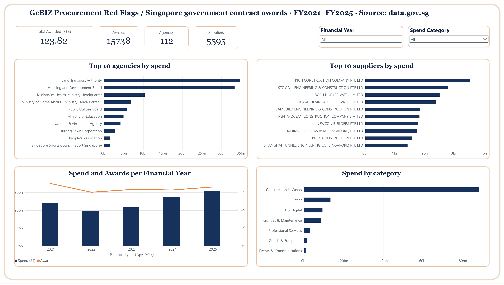
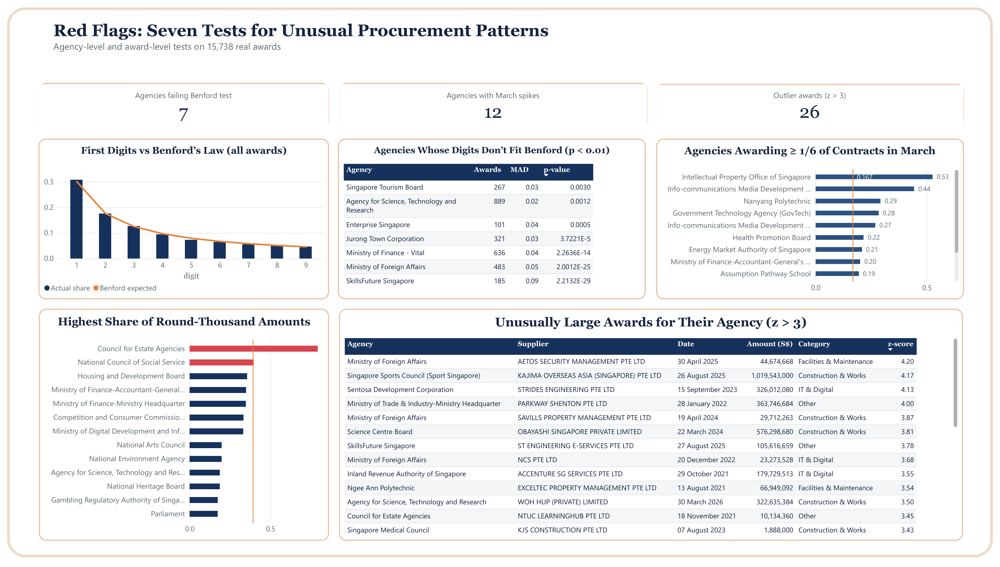
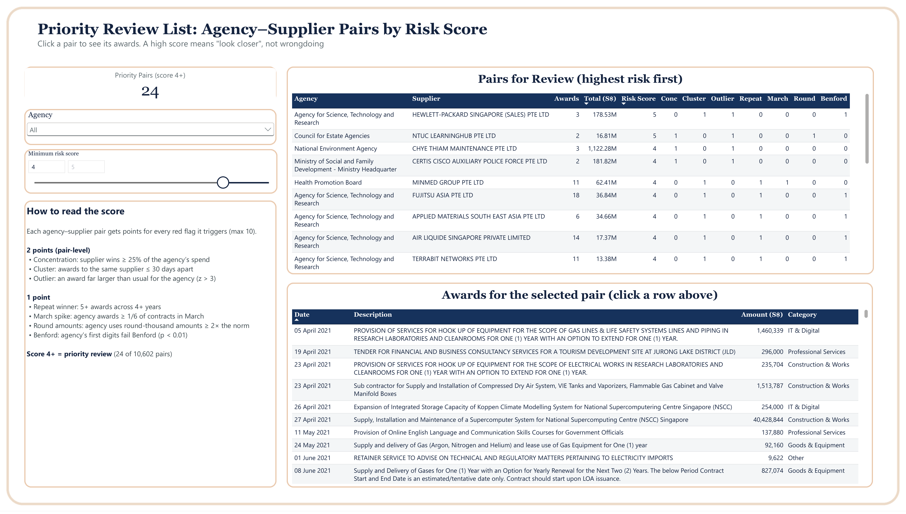

# GeBIZ Procurement Red Flags

A Power BI dashboard that screens Singapore government contract awards for unusual patterns.

**Data:** GeBIZ contract awards, FY2021–FY2025 (open data from [data.gov.sg](https://data.gov.sg))
**Scope:** 15,738 awards · 112 agencies · 5,595 suppliers · S$123.82B awarded
**Tool:** Power BI

**Live report:** [Open in Power BI](https://app.powerbi.com/groups/me/reports/cc10f999-7e39-4d98-85a3-62b4c8bfcae5/c5c8ec5acc3822206de7?experience=power-bi) (requires access to the report)

> A high score means "look closer", not wrongdoing. These are screening signals, not findings of misconduct.

## What the dashboard shows

The report has three pages.

| Page | What it answers |
|---|---|
| **Overview** | Where does the money go? Top 10 agencies and suppliers by spend, spend and number of awards per financial year, and spend by category. Filter by financial year and spend category. |
| **Red Flags** | Which agencies and awards look unusual? Seven tests, shown as charts and tables. |
| **Review List** | Which agency–supplier pairs should be looked at first? A ranked list, with the underlying awards for any pair you select. |

## The red-flag tests

| Test | What it looks for |
|---|---|
| Benford's Law | Whether the first digits of award amounts follow the pattern expected in natural data (flagged at p < 0.01) |
| March spike | Agencies that award at least 1/6 of their contracts in March, the end of the financial year |
| Outlier awards | Awards far larger than usual for that agency (z-score > 3) |
| Round amounts | Agencies that use round-thousand amounts at least 2× more than normal |
| Concentration | One supplier winning at least 25% of an agency's spend |
| Cluster | Awards to the same supplier 30 days apart or less |
| Repeat winner | A supplier with 5+ awards across 4+ years at the same agency |

## How the risk score works

Each agency–supplier pair gets points for every flag it triggers, up to a maximum of 10.

- **2 points each (pair-level):** Concentration, Cluster, Outlier
- **1 point each:** Repeat winner, March spike, Round amounts, Benford

A score of **4 or more** is a priority for review. That is 24 of 10,602 pairs.

## Screenshots

**Overview**

**Red Flags**

**Review List**

## How to open it

1. Download `dashboard/GeBIZ_Procurement_Red_Flags_v2.pbix`.
2. Open it in **Power BI Desktop** (free, Windows only). Mac users can use a Windows PC or upload the file to the Power BI web service.

The Overview and Review List pages exclude panel contracts.

## Repository structure

| Folder | Contents |
|---|---|
| `dashboard/` | The Power BI file (`GeBIZ_Procurement_Red_Flags_v2.pbix`) |
| `data/` | Data files |
| `notebooks/` | Notebooks |
| `sql/` | SQL scripts |
| `images/` | Dashboard screenshots used in this README |

## Limitations

- Red flags are statistical signals. Many have innocent explanations, such as year-end budget cycles or genuinely large projects.
- Results depend on the quality of the published open data.

## Author

Aryan Kashikar · Information Systems, Singapore Management University
