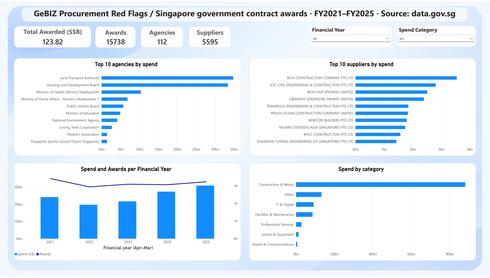
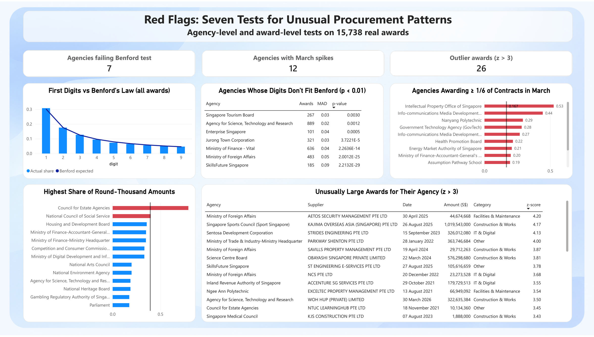
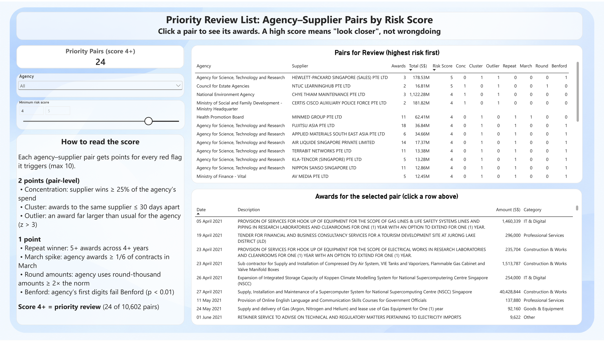

# GeBIZ Procurement Red Flags

A red-flag analysis of **Singapore government tender awards** (GeBIZ, Apr 2021 – Mar 2026). It runs 7 tests that auditors and forensic analysts use to spot unusual procurement patterns, combines them into a **risk score** for every agency–supplier pair, and presents the results in a 3-page **Power BI** dashboard.

> **A red flag is not evidence of wrongdoing.** It marks a pattern that deserves a closer look. Most flagged cases will have ordinary explanations.

**Tools:** 

· MySQL (cleaning, 5 of the 7 tests, risk score)

· Python: pandas, NumPy, SciPy, matplotlib (Benford's Law and outlier tests)

· Power BI (dashboard)

---

## Dashboard

📄 **[Full dashboard as PDF](dashboard/gebiz_dashboard.pdf)** (3 pages)

📊 **[Power BI file](dashboard/GeBIZ%20Procurement%20Red%20Flags.pbix)** (opens in Power BI Desktop on Windows)

**1. Overview:** where the money goes


**2. Red Flags:** results of the seven tests


**3. Review List:** agency–supplier pairs ranked by risk score. Click a pair to see its awards.


---

## Data

| | |
|---|---|
| Source | [Government Procurement via GeBIZ](https://data.gov.sg), data.gov.sg (public) |
| Raw rows | 18,464 tender awards, 7 columns |
| Period | 1 Apr 2021 – 31 Mar 2026 (FY2021–FY2025; Singapore's financial year runs April to March) |
| After cleaning | 17,825 awards; **15,738 real awards worth S$123.8B** used in all tests |

**Cleaning steps (`sql/02_clean.sql`)**
- Converted text dates to real dates and added financial year and month columns.
- Standardised supplier names (upper case, no dots or commas), so `ABC PTE. LTD.` and `ABC PTE LTD` count as one supplier.
- Removed tenders awarded to no one.
- Marked **2,087 panel contracts**: awards under $100 that set up an approved-supplier list rather than buy anything. They are excluded from every test, because they would inflate award counts and create fake outliers.
- Marked round-thousand amounts and gave each award a spend category from keywords in its description.

---

## The seven red flags

| # | Test | Rule | Level | Result |
|---|---|---|---|---|
| 1 | **Concentration** | One supplier wins ≥ 25% of an agency's spend (agency spend ≥ S$1M, ≥ 2 awards) | Pair | 18 pairs |
| 2 | **Repeat winner** | ≥ 5 awards across ≥ 4 financial years | Pair | 175 pairs |
| 3 | **Clustered awards** | Same agency awards the same supplier again within 30 days (different tender) | Pair | 472 awards, 347 pairs |
| 4 | **Year-end spike** | ≥ 1/6 of an agency's awards fall in March, the last month of the financial year (≥ 20 awards) | Agency | 12 agencies |
| 5 | **Outlier awards** | Award is > 3 standard deviations above its agency's usual size (log scale, agencies with ≥ 20 awards) | Award | 26 awards, 18 agencies |
| 6 | **Benford's Law** | Agency's first digits differ from Benford's Law (chi-square p < 0.01, agencies with ≥ 100 awards) | Agency | 7 of 42 agencies |
| 7 | **Round amounts** | Share of round-thousand amounts ≥ 2× the overall rate of 19.7% (≥ 20 awards) | Agency | 2 agencies |

**Risk score (`sql/05_risk_score.sql`):** each agency–supplier pair gets **2 points** for each pair-level flag it triggers (concentration, clustered awards, outlier) and **1 point** for repeat winner and for each agency-level flag (year-end, round amounts, Benford). The maximum is 10.

---

## Key findings

- **Spending is highly concentrated.** LTA and HDB together account for about 55% of all awarded value, and every one of the top 10 suppliers is a construction or engineering firm.
- **No sign of widespread number manipulation.** Across all 15,738 awards, first digits follow Benford's Law closely (MAD 0.0026, p ≈ 0.10). Seven agencies deviate significantly; SkillsFuture Singapore deviates most.
- **Year-end pressure at a few agencies.** The Intellectual Property Office of Singapore made 53% of its awards in March, against about 9.5% for all agencies.
- **Round amounts.** The Council for Estate Agencies (79% round amounts) and National Council of Social Service (40%) are far above the 19.7% norm.
- **Priority review list.** Of 10,602 agency–supplier pairs, 69% trigger no flags. **24 pairs score 4 or more.** The top two (score 5) are:
  - **A\*STAR → Hewlett-Packard Singapore:** clustered awards, an outlier award, and A\*STAR's Benford deviation.
  - **Council for Estate Agencies → NTUC LearningHub:** about 84% of the agency's spend, an outlier award, and round amounts.
- Many high-scoring pairs belong to A\*STAR, because its agency-level Benford flag adds a point to all its suppliers. Its pair-level flags are mostly repeated purchases of lab and IT equipment, which is plausible for a research agency.

---

## Limitations

- **Tenders only.** The dataset covers open tenders (ETT). Smaller purchases (quotations and small-value purchases) are not included, so the analysis does not cover the full procurement picture.
- **Contract values, not payments.** Amounts are values at award; actual spending may differ.
- **Approximate categories.** Spend categories come from keyword rules. For example, "installation" sends some equipment and IT purchases into Construction & Works (about 6% of awards). No red flag depends on categories.
- **Supplier names.** Names are standardised by simple rules, so a few related companies may still count separately.
- **Thresholds are judgement calls.** Cut-offs such as 25% concentration or 30 days come from common audit practice and the shape of this data, not a fixed standard.

---

## How to reproduce

1. **MySQL 8:** in MySQL Workbench, run the files in `sql/` in order (01 → 05).
   - In `01_load_and_explore.sql`, change the file path to where `data/gebiz_awards.csv` is on your computer.
   - `LOAD DATA LOCAL INFILE` needs `local_infile` enabled.
2. **Python:** create a virtual environment and install `pandas numpy scipy matplotlib sqlalchemy pymysql openpyxl`. Then run `notebooks/benford_and_outliers.ipynb`. It asks for your MySQL password (nothing is saved), runs tests 5 and 6, writes the results back to MySQL, and exports the dashboard data to Excel.
3. **Power BI:** load the exported Excel file and relate `awards[pair_key]` → `pair_risk[pair_key]` and `pair_risk[agency]` → `agency_flags[agency]`.

```
├── data/        gebiz_awards.csv (raw data)
├── sql/         01 load & explore · 02 clean · 03 flags 1–2 · 04 flags 3, 4, 7 · 05 risk score
├── notebooks/   benford_and_outliers.ipynb (flags 5–6, export)
├── dashboard/   gebiz_dashboard.pdf and .pbix (Power BI dashboard)
└── images/      dashboard screenshots, Benford chart
```

---

*Aryan Kashikar, BSc Information Systems, Singapore Management University*
